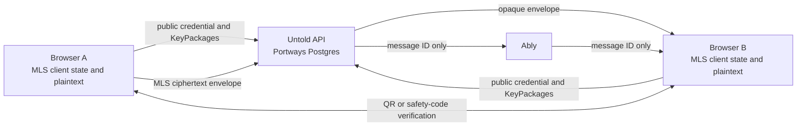

# Untold Phase 6: end-to-end encryption architecture

**Status:** Architecture and feasibility review complete. A standalone browser-native AES-GCM helper exists in [`encryption/`](../encryption/README.md), with no external crypto package. It uses a manually shared symmetric key and is not connected to device identity, message delivery, or the chat UI. The current decision remains a no-go for real-message integration until key lifecycle, identity, and a supported messaging protocol can be reviewed.

## Product and hosting boundary

Untold keeps its own product and backend: the Next.js application and API, Better Auth accounts, Portways Postgres, conversation membership and public device-key directory, opaque message storage, and Ably notifications. Ably notifications carry message identifiers only; message bytes are fetched from the authenticated Untold API.

Cryptography must run in the user's browser. The server must never receive message plaintext or private device keys. The backend may store public MLS credentials and one-time KeyPackages, group routing metadata, and opaque MLS ciphertext. This uses a maintained crypto library as an engine; it does not adopt Matrix, Wire's hosted messaging service, or Wire's backend.

## Proposed protocol direction

Use the IETF Messaging Layer Security protocol (MLS, RFC 9420) for one-to-one and group conversations. Do not invent cryptographic algorithms or a full messaging protocol. The separate `encryption/` package contains an experimental AES-GCM helper using built-in Web Crypto; it is a limited symmetric-encryption building block, not the planned multi-device/group protocol.

OpenMLS is now the strongest protocol-engine candidate. Version 0.9.1 is MIT-licensed, actively maintained, and the OpenMLS project reports an SRLabs audit sponsored by the Sovereign Tech Agency. The project says seven findings, including the high-severity issue, were fixed in released versions; one low-severity finding remains in progress. This audit applies to OpenMLS, not automatically to a browser adapter, persistence layer, or Untold integration.

The OpenMLS repository contains `openmls-wasm`, but labels it an experiment and a starting point for custom bindings. The crate is marked `publish = false`. The core OpenMLS tests do run in a `wasm32-unknown-unknown` CI job; that job tests `openmls`, not the `openmls-wasm` JavaScript wrapper. The feature request for a supported JavaScript API remains open. No Rust toolchain is installed in this workspace, so we cannot build or validate the wrapper locally.

### OpenMLS browser integration gates

- **Supported browser API:** OpenMLS's `openmls-wasm` crate is labeled an experiment, is unpublished, and is described as a starting point for custom bindings. Upstream CI runs the core OpenMLS tests on `wasm32-unknown-unknown`, but does not test the wrapper crate through a browser JavaScript API. Do not treat the Rust API as a supported JavaScript API.
- **Wrapper completeness:** The current wrapper exposes only a small set of operations. Its source has panic paths (`unwrap`), unimplemented incoming-message cases (`todo!`), and no JavaScript-facing import/export contract for a user's complete private MLS state. Its source tests do not establish browser persistence or Untold transport behavior. These are direct integration gaps, separate from the audited protocol engine.
- **Independent review:** SRLabs audited OpenMLS, and the OpenMLS project reports seven findings fixed in released versions plus one low-severity finding still in progress. That does not cover an Untold WASM wrapper, the browser state store, or the full app integration. Review those separately.
- **Local state:** Design and review how MLS private state is persisted, unlocked, erased, and recovered. Do not improvise key wrapping or a passphrase KDF. At-rest encryption does not protect an unlocked session from same-origin malicious JavaScript.
- **Custom-service contract:** Prove that the selected binding can use Untold's membership checks, device identity format, KeyPackage lifecycle, and opaque envelope endpoints without relying on a third-party messaging service.
- **Build and update path:** Pin released versions, verify published artifacts against reviewed source, and establish a reproducible browser build. Do not rely on undocumented APIs or an unmaintained fork.

### Additional browser candidate checked

`@vanishing.page/webcrypto-mls` 0.0.11 is a TypeScript MLS implementation that directly uses the browser Web Crypto API and documents a fail-closed default credential validator. Its package metadata points to `LICENSE`, which is the Big Time Public License; the repository also contains a separate `LICENSE_MIT`, but the published package metadata does not select it. The repository's `AUDIT-ra.md` is a detailed review of the random-access attachment branch, not an independent audit of the MLS core. This package is therefore not selected for a security-critical integration.

### Other implementation routes checked

| Candidate | What fits | Why it is not selected now |
| --- | --- | --- |
| OpenMLS 0.9.1 + `openmls-wasm` | MIT license; active maintainers; external SRLabs audit of OpenMLS; the core supports RFC 9420 and its core tests run on the WASM target in upstream CI. | The JS/WASM crate is explicitly experimental and unpublished; upstream's WASM test job covers the core crate, not this wrapper. The wrapper is incomplete and exposes no complete browser state-persistence contract. Untold would own security-critical bindings and browser persistence without being able to build or validate that path in this workspace. |
| `@vanishing.page/webcrypto-mls` 0.0.11 | Browser-native TypeScript MLS over Web Crypto; documented identity validation and IndexedDB persistence. | Package metadata selects the Big Time Public License; no independent audit of the MLS core was found. The repository's attachment-branch audit is not such an audit. |
| Wire CoreCrypto | Rust MLS core, browser WebAssembly bindings, and a custom `MlsTransport` interface. | GPL-3.0 license needs product review; its documented WebAssembly keystore has not been validated or audited; the available older Proteus audit does not cover current MLS/WASM/browser storage. |
| AWS `mls-rs` | IETF MLS implementation, WASM builds, configurable storage, Apache-2.0/MIT license. | Its own README marks the Web Crypto provider experimental and says the library has not had a full third-party security audit. The repository does not provide a supported browser JavaScript client API, so adopting it would require us to own and maintain bindings and storage integration. |
| OpenE2EE Signal Protocol JS SDK | Browser support and a custom relay interface. | The maintainers state that it has no independent-firm audit. Its documented profile is not wire-compatible with Signal Messenger or `libsignal`, and its own documentation lists protocol deviations. It is not a better fit than using an MLS standard implementation here. |

OpenMLS is the best protocol engine on license and audit evidence, and its core has WebAssembly test coverage. Its official browser binding is still not a supported product surface. CoreCrypto has a custom transport seam but retains license and keystore gaps. The browser-native TypeScript alternative has a restrictive package license and no independent audit of its MLS core. No candidate clears the browser API, local-state, and review gates together.

**Decision:** At the user's direction, add a separate dependency-free encryption project using the browser's built-in Web Crypto API. Its AES-GCM helper is only a symmetric-encryption building block; it does not replace MLS or provide key exchange, verified identity, forward secrecy, replay prevention, device lifecycle, or secure storage. Keep real chat messages disconnected until those pieces have a reviewed design and implementation. Do not write custom bindings or storage as a substitute for a supported browser API without independent security review. The `crypto/` package remains the app integration boundary. Do not represent chat messages as end-to-end encrypted.

## Data flow

The diagram describes the intended data boundary. It does not imply that the implementation or identity-verification flow exists.

## Threat model

### Protection goals

- A Portways database leak, hosting operator, Ably operator, or network observer must not be able to read message or attachment plaintext.
- A malicious or compromised backend must not be able to silently substitute a conversation member's device keys after users have verified identity.
- Tampered, malformed, stale, duplicate, or reordered envelopes must be rejected or handled according to the selected MLS implementation's documented behavior and tested integration.
- Removing a device must prevent it from decrypting future group epochs after members process the corresponding MLS removal commit.

### Assumptions and limits

- Users run a trusted, current browser and receive Untold's intended code over HTTPS.
- Browser extensions, same-origin XSS, malicious dependencies, or a compromised deployment can access plaintext while the app is unlocked. A web app cannot protect keys from JavaScript delivered by its own origin.
- The backend can delay, withhold, reorder, replay, or delete ciphertext and can observe account/device identifiers, membership, IP addresses, timing, ciphertext sizes, and availability patterns. Encryption does not hide this metadata or guarantee delivery.
- Recipients can copy, export, screenshot, or disclose plaintext after decryption. Device revocation cannot erase content already copied or decrypted.

## Identity, devices, and MLS state

- Each browser installation is a distinct Untold device with its own MLS identity and persisted MLS state. The Better Auth password is only for account access; it must not become the MLS private key or silently recover MLS state.
- Register only public credentials and one-time KeyPackages with the Untold API. The server serves them to authenticated, authorized peers and atomically marks one-time packages as consumed. Private key material remains in the browser's crypto state.
- Initial device identity must be verified out of band (for example, a QR or safety-code comparison) and changes must be clearly presented. Account login alone does not prove that a device key belongs to the intended person. A first-contact trust model, key-change policy, and possible transparency mechanism remain to be finalized against supported library APIs.
- A conversation maps to an MLS group. Each user's devices are members of the MLS group, so new messages are delivered to the approved devices in the current group epoch. Adding or removing devices requires a valid MLS membership update and a visible identity-change flow.
- The application must rely on the selected library's MLS state machine and replay protection. Add app-level idempotency for transport retries, but do not create a parallel cryptographic replay scheme.
- Browser state at rest, vault unlock, lock timeout, multi-tab coordination, backup, and secure deletion require an explicit design based on the selected library's documented support. No custom key wrapping or passphrase KDF should be improvised.

## Message and delivery handling

1. The sender constructs the message in the browser and passes it to the MLS application-message API.
2. The browser sends only the resulting opaque MLS envelope and an idempotency identifier to the authenticated conversation endpoint.
3. The API checks membership and size limits, stores the envelope as bytes, and publishes a message-available identifier to the authorized Ably conversation channel.
4. Recipients fetch the envelope and decrypt it in the browser through the MLS library.
5. The server never indexes plaintext, generates plaintext previews, or logs message bodies. Notifications and telemetry contain no plaintext.

Ably remains an ID-only notification service; it is not the message database or cryptographic authority. The client must fetch every envelope through the Untold API, where account and current membership are checked.

## Attachments, recovery, and metadata

- Attachments remain disabled until the selected library has a supported, reviewed attachment-encryption path. The server must receive ciphertext only; filename, size, MIME type, and upload timing can still reveal information.
- Account recovery restores account access only. It must not restore old MLS state unless a separate, user-controlled cryptographic recovery design has been reviewed and implemented with supported library APIs. The first secure version should prefer unrecoverable old history over server-held private keys.
- Message previews stay off by default. Do not put plaintext in logs, push payloads, page URLs, analytics, crash reports, or Ably events.

## Verification before real-message rollout

Before enabling the message UI against the backend, complete all of the following:

1. Choose a protocol engine and establish a supported browser path. The preferred engine candidate is OpenMLS; its current official WASM bindings need a supported, tested release or a separately reviewed Untold wrapper.
2. Design and review browser state storage, device identity, verification, lock/unlock, and loss/recovery behavior. Do not improvise key wrapping or a passphrase KDF.
3. Pin and review the exact crypto package and transitive dependencies; verify published artifacts against reviewed source and establish a reproducible WASM build path.
4. Add the backend device/key-package directory and ordered, paginated message history that MLS transport needs to recover groups in sequence.
5. Build a two-browser integration harness against the Untold API and Ably ID-only event flow. Confirm the database and realtime payloads contain no plaintext or private key material.
6. Cover tampering, malformed messages, duplicate delivery, replay, out-of-order delivery, membership changes, KeyPackage reuse, key changes, unverified devices, device removal, browser reload, multi-tab access, storage corruption, and recovery/loss behavior.
7. Run supported browser targets and inspect deployed headers and error/logging paths. Keep attachments and history recovery off until those paths have equivalent coverage.
8. Arrange an independent security review of the selected implementation version and Untold's integration before making a production E2EE claim.

Until those checks pass, the existing message screens remain local mock previews, and the hosted message API must not receive real user conversation content.

## References

- [IETF MLS Protocol (RFC 9420)](https://www.rfc-editor.org/rfc/rfc9420.html)
- [OpenMLS 0.9.1 release and license](https://docs.rs/crate/openmls/0.9.1)
- [OpenMLS independent SRLabs audit summary](https://blog.phnx.im/openmls-independent-security-audit/)
- [OpenMLS WASM bindings experiment](https://github.com/openmls/openmls/tree/main/openmls-wasm)
- [OpenMLS WASM target support](https://github.com/openmls/openmls)
- [OpenMLS WASM binding source](https://github.com/openmls/openmls/tree/main/openmls-wasm)
- [OpenMLS current WASM CI job](https://github.com/openmls/openmls/blob/main/.github/workflows/tests.yml)
- [OpenMLS JavaScript API request](https://github.com/openmls/openmls/issues/487)
- [`webcrypto-mls` package manifest](https://github.com/vanishing-page/webcrypto-mls/blob/main/package.json)
- [`webcrypto-mls` attachment-branch review](https://github.com/vanishing-page/webcrypto-mls/blob/main/AUDIT-ra.md)
- [Wire CoreCrypto source and license](https://github.com/wireapp/core-crypto)
- [CoreCrypto architecture and browser keystore status](https://wireapp.github.io/core-crypto/ARCHITECTURE.html)
- [CoreCrypto release notes, including the MLS transport interface](https://github.com/wireapp/core-crypto/blob/main/cc-book/src/release_notes.md)
- [Kudelski Security and X41 Proteus review (2017)](https://x41-dsec.de/static/reports/Kudelski-X41-Wire-Report-phase1-20170208.pdf)
- [`mls-rs` support, license, and security notice](https://github.com/awslabs/mls-rs)
- [OpenMLS JavaScript API request](https://github.com/openmls/openmls/issues/487)
- [OpenE2EE assurance statement](https://github.com/open-e2ee/signal-protocol-js/blob/main/docs/ASSURANCE.md)
- [OpenE2EE documented Signal-profile differences](https://github.com/open-e2ee/signal-protocol-js/blob/main/docs/DEVIATIONS.md)
