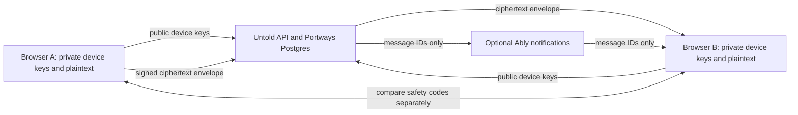

# Untold Phase 6: first-party browser encryption

**Status (2026-10-15):** A first-party, one-to-one message encryption flow is connected to the app. The code is in [`crypto/src/protocol.ts`](../crypto/src/protocol.ts), has no external cryptography package, and runs in the browser. It uses the browser's built-in Web Crypto API. This is an early custom protocol, not an independently reviewed or production-secure implementation.

## Scope and product boundary

- Untold owns the application, device directory, message API, and Postgres storage. No Matrix, Megolm, Signal, or Wire messaging service is used.
- The crypto code is imported into the Next.js client bundle. The `crypto/` folder is a standalone package boundary and can be built with `npm run build:crypto`; it does not need its own hosted API or server.
- Ably remains an optional realtime notification provider for message IDs only. Messages are fetched from Untold's authenticated API. Ably can observe IDs, timing, and connection metadata.
- One-to-one conversations support encrypted text and the encrypted files documented in [Phase 8](phase-8-encrypted-attachments.md). Migration `006-purge-plaintext-messages.sql` removes rows that are not structurally valid protocol-v1 envelopes. This deletes pre-encryption chat history from the live database; host backups may retain earlier copies.

## Protocol v1

This is an Untold-defined message envelope built from browser-standard primitives. It does not implement the primitives itself and does not import a crypto library.

1. Each browser creates a P-256 ECDH key pair for key agreement and a separate P-256 ECDSA key pair for message signatures. Private `CryptoKey` objects are non-extractable and stored in IndexedDB, keyed to the signed-in account. The public SPKI keys are registered with the Untold API.
2. For each message, the sender creates a fresh random 256-bit content key and a fresh 96-bit AES-GCM nonce. The text is encrypted with AES-256-GCM; conversation ID, message ID, sender account, and sender device are authenticated as additional data.
3. The content key is wrapped separately for every approved device in the conversation. Each wrap derives an AES-GCM key from static ECDH P-256 plus HKDF-SHA-256, a fresh random salt, and conversation/message/device context.
4. The sender signs the canonical envelope with its device ECDSA key. The server checks the sender/device/membership and that the wrapped-key list matches the current approved device directory, but it cannot verify the message signature or decrypt the text.
5. A recipient verifies the sender signature and the local trust record before unwrapping the content key and decrypting the message. A contact account is compared once through a separate trusted channel. Additional devices inherit trust only through signed device approval; an account identity reset requires a new comparison.

The server accepts at most 8 devices per account and 32 devices per conversation. Message history remains capped at the latest 100 items per API response.

## Data flow

The database stores the public device-key directory, account/conversation metadata, and encrypted message envelopes. The server still sees sender and recipient accounts, device IDs, message timestamps, approximate message sizes, IP and connection metadata, and delivery activity.

## Trust and key lifecycle

- The shared contact safety code hashes both stable account identities. Device approval certificates bind additional device keys to that identity, and signed contact attestations sync comparisons between approved devices. Pending devices do not participate in new messages or block existing chats. Identity changes pause sharing until a new comparison. See [account device verification](account-device-verification.md) for migration, linking, recovery, and remaining review requirements.
- First-contact verification depends on the user actually comparing the codes. A malicious server could substitute keys before the first comparison. The app does not have a key-transparency service.
- A device can be revoked from account settings. The server retains its public key for verifying old message signatures, excludes it from new key wraps, and expires the account's other sessions. Revocation cannot erase downloaded history or ciphertext/key wrappers already stored.
- Keys are not backed up or recoverable. Clearing browser data or losing the browser profile can make old messages unreadable. A newly added device cannot open messages sent before it was registered.

## Security limits

- **No forward secrecy or post-compromise security.** Static ECDH identity keys are reused for message-key wrapping. If a device's private agreement key is later compromised, previously stored messages addressed to that device may be decryptable. There is no ratchet or periodic secret update.
- **No independent security review.** The protocol format, implementation, identity flow, browser persistence, and integration have not been audited. Do not describe this release as production-secure or use it for high-risk conversations.
- **Web origin trust.** The same Untold origin serves the JavaScript that handles plaintext and keys. A malicious deployment or same-origin script compromise can read plaintext while the app is open. Non-extractable keys do not protect against authorized same-origin script using them.
- **Recipient-controlled plaintext.** A recipient controls message text after their verified device decrypts it; a recipient choosing to share that text is outside Untold's server-side confidentiality responsibility. Unauthorized access to an unlocked or compromised device, or malicious software on it, can expose messages and remains an endpoint security risk.
- **Browser storage limits.** Private keys are stored in IndexedDB without an account recovery mechanism or user-controlled vault password. Browser profiles, extensions, malware, and unlocked devices are part of the trust boundary.
- **No group chat, message editing/deletion, or push notifications.** File attachment support is limited to Phase 8's 20 MiB per-file upload and safe previews.
- **Legacy content and backups.** Migration 006 deletes pre-encryption and malformed message rows from the live database; it does not encrypt them. Backups made before migration may still contain plaintext, according to the host's retention policy.

## Deployment and review gates

Migrations `004-e2ee-devices.sql` and `005-device-revocation.sql` create the device directory and revocation state. Migration `006-purge-plaintext-messages.sql` removes all stored rows that are not structurally valid protocol-v1 envelopes. Portways applies these migrations during app startup. The client imports [`crypto/src/protocol.ts`](../crypto/src/protocol.ts) directly; no secret key or plaintext is sent to a crypto server. Run `npm run build:crypto` to compile the standalone package and `npm run build` for the site.

Before calling Untold production-secure, the protocol needs independent cryptographic review, dedicated tests for key derivation, message tampering, signature verification, nonce handling, device changes/removal, stale device directories, storage loss, and two-browser delivery, plus deployment-level review of the served client code and origin. This workspace update has not completed those reviews.

## References

- [W3C Web Cryptography API](https://www.w3.org/TR/WebCryptoAPI/)
- [W3C Indexed Database API](https://www.w3.org/TR/IndexedDB/)
- [IETF Messaging Layer Security (RFC 9420)](https://www.rfc-editor.org/rfc/rfc9420.html) — reference for forward secrecy and post-compromise security properties that Untold protocol v1 does not provide.
