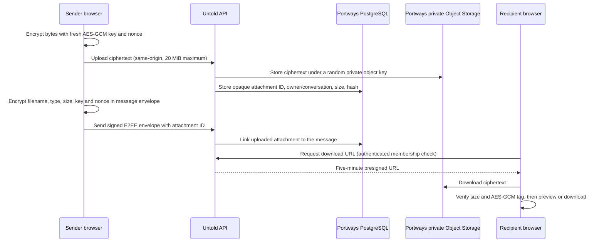

# Phase 8: encrypted attachments

**Status (2026-10-15):** Attachment sharing is implemented locally for existing one-to-one conversations. A live Portways Object Storage add-on and two-browser verification are still required before release.

## Scope

Share one file per message, with up to five selected for sequential sending. Accept images, video, audio, PDFs, office documents, and other file types up to 20 MiB each. Supported raster images can preview when they enter view; video and audio play after the user chooses to load them. Other formats download as opaque files. File uploads do not add calling, group chat, status feeds, or other WhatsApp features.

The 20 MiB limit keeps one upload below Portways' documented 25 MB S3 public-request limit. It also bounds browser/server memory use for the current whole-file AES-GCM operation. Larger file support would need a chunked authenticated-encryption format and multipart S3 uploads.

## Data flow

The object bucket is private. The upload endpoint checks the session, browser origin, conversation membership, active sending device, file size, and per-user upload rate limit before storing anything. It accepts only `application/octet-stream`; the browser sends already-encrypted bytes. Message creation links the attachment only when its upload record belongs to the same sender and conversation. Download URLs are issued only after checking conversation membership and a committed message link.

The storage object key is random and is not returned to the browser. The database stores its object key, attachment ID, sender/conversation relationship, ciphertext byte count, and SHA-256 digest. It does not store a filename or MIME type. Those fields, the plaintext size, AES key, and nonce are encrypted inside the E2EE message body. The object store and API still see ciphertext size and timing; the API also sees which account and conversation own the attachment.

## Attachment encryption

Each file uses a fresh random 256-bit AES-GCM key and 96-bit nonce. Additional authenticated data binds the ciphertext to the conversation ID, message ID, sender account, sender device, and attachment ID. The key and nonce are included only in a manifest inside the existing signed E2EE message envelope. The encrypted file is not placed in the message envelope or exposed to Ably.

On receipt, Untold first checks the message signature and verified sender-device state. The browser then matches the decrypted manifest's attachment ID to the API record, downloads ciphertext, checks its exact expected length, and decrypts/authenticates it before creating a local blob URL. SVG, HTML, PDF, and office files are never embedded as active page content; unsupported preview types download as `application/octet-stream`. Raster images, video, and audio use explicit safe MIME allowlists for inline playback.

This builds on the existing protocol v1 key wrapping, which still has no forward secrecy or independent review. Attachment encryption does not fix those protocol limitations. The object storage is Portways' own MinIO-backed S3-compatible add-on; AWS SDK v3 packages are used only to speak that S3 API and sign short-lived private download URLs. No Amazon hosted bucket or third-party encryption service is used.

## Portways setup

1. Link a Portways **Object Storage (S3)** add-on to the existing Untold app project. The link provisions a private bucket and scoped credentials.
2. Keep the generated S3 credentials server-only. Portways supplies `S3_ENDPOINT`, `S3_REGION`, `S3_BUCKET`, `S3_ACCESS_KEY_ID`, `S3_SECRET_ACCESS_KEY`, and `S3_FORCE_PATH_STYLE`; it supplies `S3_INTERNAL_ENDPOINT` when the app can reach the add-on inside the cluster.
3. Do not enable public bucket reads or configure a CDN for this private message bucket. Portways updates its S3 CORS allowlist when projects/custom domains are linked; the browser only uses presigned downloads.
4. Deploy the app. Migration `007-encrypted-attachments.sql` creates the attachment table and optional message attachment ID. Migrations run before the app accepts requests.
5. Verify attachment sending and receiving from two separate browser profiles on the deployed origin.

The repository's [Portways hosting guide](../portways-hosting-guide%20%283%29.md) documents object storage quotas, request limits, backups, CORS, and preview prefixes. By default, the add-on has a 5 GB project bucket limit and daily backups retained for 14 days; check the Portways dashboard for the current quota and retention before launch.

## Release checks

- Confirm migration 007 applies on a current Portways database and reruns safely.
- Link the Portways storage add-on and confirm `S3_*` values are present only in the server environment.
- Send and receive a raster image, a video or audio clip, a PDF, and an arbitrary file. Verify in-browser previews/decryption, generic downloads, upload progress, retry, discard, and the 20 MiB rejection.
- Confirm unauthenticated callers, conversation outsiders, and unlinked attachment IDs cannot obtain a download URL.
- Confirm the object bucket remains private and contains ciphertext, not original file bytes, names, or media types.
- Review Portways storage quota, backup retention, deletion/orphan handling, dependency audit, and the deployed site's request-size behavior.
- Arrange independent review of the full E2EE protocol, including the attachment context and key handling.

## References

- [Portways object storage guide](../portways-hosting-guide%20(3).md)
- [AWS SDK for JavaScript S3 presigner package](https://docs.aws.amazon.com/AWSJavaScriptSDK/v3/latest/Package/-aws-sdk-s3-request-presigner/)
- [S3 presigned URL behavior](https://docs.aws.amazon.com/AmazonS3/latest/userguide/using-presigned-url.html)
- [Phase 6 encryption protocol and limits](phase-6-e2ee-architecture.md)
